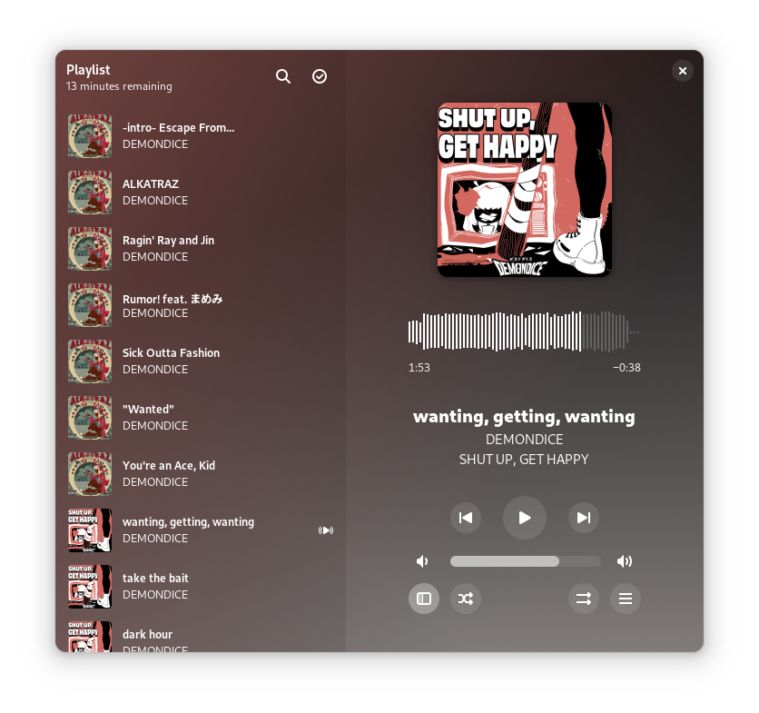
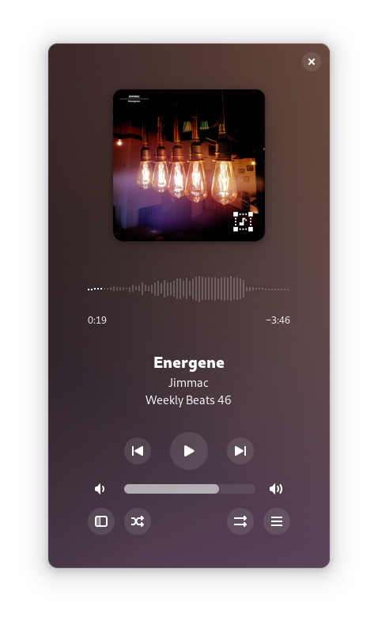

Amberol
=======

A small and simple sound and music player that is well integrated with GNOME.

Amberol aspires to be as small, unintrusive, and simple as possible. It does
not manage your music collection; it does not let you manage playlists, smart
or otherwise; it does not let you edit the metadata for your songs; it does
not show you lyrics for your songs, or the Wikipedia page for your bands.

Amberol plays music, and nothing else.

Flatpak builds
--------------

The recommended way of installing Amberol is through Flatpak. If you don't have
Flatpak installed, you can get it from [the Flatpak website](https://flatpak.org/setup).

You can install stable builds of Amberol from [Flathub](https://flathub.org)
by using this command:

    flatpak remote-add --if-not-exists flathub https://flathub.org/repo/flathub.flatpakrepo
    flatpak install flathub io.bassi.Amberol

Windows development build
-------------------------

Amberol can be built as a native Windows program with the MSYS2 UCRT64 toolchain.
Open the **MSYS2 UCRT64** terminal, update MSYS2, then install the build and
runtime packages:

    pacman -Syu
    pacman -S --needed mingw-w64-ucrt-x86_64-toolchain mingw-w64-ucrt-x86_64-rust mingw-w64-ucrt-x86_64-meson mingw-w64-ucrt-x86_64-ninja mingw-w64-ucrt-x86_64-pkgconf mingw-w64-ucrt-x86_64-python mingw-w64-ucrt-x86_64-gtk4 mingw-w64-ucrt-x86_64-libadwaita mingw-w64-ucrt-x86_64-gstreamer mingw-w64-ucrt-x86_64-gst-plugins-base mingw-w64-ucrt-x86_64-gst-plugins-good mingw-w64-ucrt-x86_64-gst-plugins-bad mingw-w64-ucrt-x86_64-gettext-tools

From this source directory, run:

    meson setup build-win --prefix="$(cygpath -m /ucrt64)"
    meson compile -C build-win
    meson devenv -C build-win build-win/src/amberol.exe

The development environment supplies the GSettings schema and other data files.
For an installed build, run `meson install -C build-win`, then launch
`/ucrt64/bin/amberol.exe` from UCRT64. GStreamer codecs and the GTK runtime must
remain installed. This is a development build procedure, not a standalone
installer. System media controls use Souvlaki: MPRIS on Linux and Windows media
controls on Windows. Unix platforms, including FreeBSD, use MPRIS.

To assemble a portable Windows package, run
`python build-aux/package-windows.py` after compiling. It copies `Amberol.exe`,
its UCRT64 DLL dependencies, GTK data, translations, and common GStreamer audio
plugins into `dist/amberol-windows-portable`, then creates
`dist/amberol-windows-portable.zip`.
Users can extract the ZIP and double-click `Amberol.exe`; the whole extracted
folder must remain together. The executable locates the bundled resources and
selects Simplified Chinese without a batch file. Re-run the packaging command
after changing the binary. Review bundled library licenses and test supported
audio formats before redistribution. While waveform analysis runs, a seekable
progress line remains visible; completed waveforms are cached.

Getting in touch
----------------

If you have questions about Amberol, you can join the [`#amberol:gnome.org`](https://matrix.to/#/#amberol:gnome.org)
channel on Matrix, or use the [GNOME Discourse instance](https://discourse.gnome.org/c/applications/7).

Contributing
------------

Please, see the [contribution guide](./CONTRIBUTING.md) if you wish to report
and issue, fix a bug, or implement a new feature.

How to obtain debugging information
-----------------------------------

Run Amberol from your terminal using:

    RUST_BACKTRACE=1 RUST_LOG=amberol=debug flatpak run io.bassi.Amberol

to obtain a full debug log.

Translations
------------

Amberol is translated on the [GNOME translation platform](https://l10n.gnome.org/module/amberol).

You should contact the coordinator of [the localization team for your language](https://l10n.gnome.org/teams/)
if you have questions.

For more information, please see the [GNOME Translation Project wiki](https://wiki.gnome.org/TranslationProject).

Code of conduct
---------------

Amberol follows the GNOME project [Code of Conduct](./code-of-conduct.md). All
communications in project spaces, such as the issue tracker or
[Discourse](https://discourse.gnome.org) are expected to follow it.

Why is it called "Amberol"?
---------------------------

The name comes from the the [Blue Amberol
Records](https://en.wikipedia.org/wiki/Blue_Amberol_Records), a type of cylinder
records made of (blue) nitrocellulose, capable of playback durations of around
four minutes, just about the length of the average song since 1990.

Copyright and licensing
-----------------------

Copyright 2022  Emmanuele Bassi

Amberol is released under the terms of the GNU General Public License, either
version 3.0 or, at your option, any later version.
